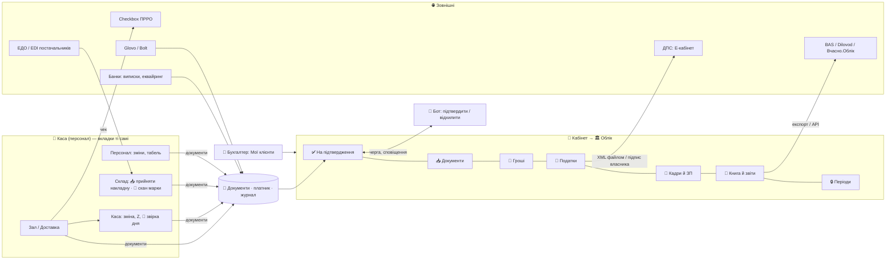

# 🏛 Фінальний план «Одна система замість 1С» — v1.0 (2026-10-19)

**Мета:** ресторан працює в **одній програмі ATOM** замість 5–7 (POS + ПРРО + 1С/BAS + зарплата + M.E.Doc + клієнт-банк + ЕДО). Людина лише підтверджує. Звіряти руками нічого не треба.

**Статус:** планування завершено, план затвердив власник. Код пишемо лише за командою «старт». Будь-яка зміна фундаменту — спершу правка цього файлу, потім код.

Джерела:
- дослідження `reports/Одна система замість 1С.md` (поза репо) + `research_notes/`;
- історія обговорення — git-журнал цього файлу (коміти 336c22c…4ad9bf5).

Пов'язано: `prro-plan.md`, `податки.md`, `податки-ux.md`, `платформа-експорт.md`, `stock.md`, `money.md`, `roadmap.md`.

Позначки: ✅ є в коді · 🟡 частково · ⬜ немає · ❓ перевірити · ⚖️ рішення власника/бухгалтера.

---

## 0. Непорушні правила (для кожного етапу)
1. **Тести** — лише на `worker-test` і atom-demo. Фіскал — тільки на тестовій касі Checkbox. На робочому сервері — без тестових чеків, звітів і працівників.
2. **У ДПС з тестів нічого не подаємо.** XML перевіряємо на файлах. Подання — лише на явну дію людини.
3. **Секрети** (токени банків, ЕДО, Checkbox) зберігаються в базі закладу зашифрованими.
   - Ключі шифрування — лише `wrangler secret put`.
   - Репо приватне, але без персональних даних і секретів.
   - **КЕП ATOM не зберігає.**
4. **Паритет бот ⇄ каса.** Для обліку бот дає сповіщення, чергу «✅ підтвердити / ❌ відхилити» і посилання. Таблиці — лише в кабінеті.
5. **Економія запитів:**
   - вебхуки або фонова справа раз на добу в будильнику закладу (`store.js` `alarm()` → `cron()` у `site.js`);
   - без опитування;
   - нові формати даних — лише через `migrate.js`, старий формат має читатися.
6. **ATOM не дає податкових порад.** Він рахує і готує документи. Ставки й дати підтверджують власник і бухгалтер. Дисклеймер з `податки-ux.md` (розділ A) — на кожному податковому екрані.
7. **Людина підтверджує** кожен документ, що йде в держоргани чи банк. Автоматично робляться лише розрахунки й чернетки.
8. **Стан закладу не тримаємо в глобальних змінних модулів.** Ліміти безпеки не послаблюємо.
9. **Кожен етап закінчується так:**
   - свій тест у `selftest.mjs`;
   - `sh tools/test.sh`;
   - оновлений паспорт `_team/*.md`;
   - `sh tools/deploy.sh`;
   - push (робить лише керівник).

---

## 1. Рішення власника

| Питання | Рішення |
|---|---|
| Офлайн | **Таймер-підказка.** Телефони майже завжди мають зв'язок (роздача з телефона). Чек можна пробити без телефона гостя — Checkbox дає електронний чек. Міст до Checkbox Kasa на ПК і свій ПРРО — не зараз |
| КЕП | Ключ не зберігаємо (власник погодився). Спосіб підпису для прямого подання — **⚖️ подумаємо**. До рішення подаємо **файлом**: ATOM готує XML, власник підписує в Е-кабінеті |
| Android-застосунок | **Переносимо** (пізніше: Bluetooth-принтери, термінал, легальні офлайн-коди) |
| ТОВ на загальній | **Робимо обидва шляхи:** експорт у BAS/1С бухгалтеру + підключення партнерської бухгалтерії (Dilovod / Вчасно.Облік) через API |
| Кабінет бухгалтера «Мої клієнти» | **Робимо** — це і роль, і канал продажу |
| Сканер DataMatrix | Перевіримо, коли власник підключить сканер. **Плюс камера телефона** |
| Повна бухгалтерія | Свій план рахунків і проводки **не будуємо**. ФОП і ЄП — книга доходів. ТОВ на загальній — експорт або партнер |
| 💡 Простий старт | Хто хоче **лише видавати чеки** — бачить тільки касу. Облік, податки, кадри, перехід — модулі, які вмикаються в налаштуваннях однією кнопкою (Ф13). Попередження про ліміт ФОП працює завжди |

---

## 2. 🧱 Фундамент (будуємо першим, без нових екранів)
Чому: план звірено з кодом. Знайдено діри, через які облік неможливо будувати «на потім».
- Закриті чеки можна правити.
- Бекапи зберігаються 7 днів, а закон вимагає 3 роки.
- ФОП записаний лише в чеку.
- Ліміт ФОП рахується окремо в кожному закладі (`fis:yr`), а не по всіх закладах ФОП.
- Гроші — дробові гривні.
- Дані лежать денними JSON-блоками.
- Немає журналу змін і суцільної нумерації.

| # | Рішення | Що закриває |
|---|---|---|
| Ф1 | **Одна модель «Документ»** для всього: `{id, тип, платник, дата обліку, номер, статус чернетка→проведено→сторно, рядки, сума (коп.), автор, джерело: каса/бот/імпорт/банк/ЕДО, зовн. ключ (GUID 1С)}`. Документ не видаляється; виправлення = сторно | Накладна, списання, ПКО/ВКО, ЗП, інший дохід, передача між платниками — один механізм, один експорт |
| Ф2 | **Платник** (ФОП/ТОВ) — на рівні власника (Hub): режими з датою початку, ліцензії, каси, рахунки, працівники. Заклад і кожен документ посилаються на платника. Заклади раз на добу передають платнику підсумки | Ліміт групи і поріг ПДВ по всіх закладах; декларація на ФОП; алкоголь — на ФОП з ліцензією |
| Ф3 | **Гроші — цілі копійки** в нових даних (міграція, старі дані читаються) | Копійки не «пливуть» |
| Ф4 | **Облікова дата** — одна функція: Київ із літнім часом + межа операційного дня закладу в налаштуваннях | Зміна після півночі, Z, банк зараховує завтра |
| Ф5 | ✅ 22.10 (вручну: каса Звіти → 🔒 Період, бот `закрити період 09.2026`; `plock.js`, «шлагбаум» у `pos.js` + `ledger.js`; авто після звіту — ⬜) **Замок періоду.** Місяць закривається вручну або сам після подання звіту. Закритий чек минулого періоду не правиться — лише повернення сьогодні (+ уточнююча декларація) | Цифри не розходяться з ДПС |
| Ф6 | **Журнал змін** — SQL-таблиця лише на дописування: хто, що, коли, було→стало. Окремо — журнал доступу до персональних даних | Бухгалтер, перевірки, суперечки, Закон про захист персональних даних |
| Ф7 | **Облік — SQL-таблиці в DO закладу** (Store уже на SQLite) з індексами: дата, платник, тип | Швидкі річні звіти на 1000 закладів |
| Ф8 | **Архів 3+ роки:** щомісячний знімок у R2 + перевірка відновлення. 7-денні бекапи лишаються | ПКУ ст. 44.3 (≥1095 днів) |
| Ф9 | **Ставки, мінімалки, ліміти, форми «діють з дати»** (таблиця, а не рік). Тест падає, якщо ставки застаріли | ВЗ і МЗП посеред року, нові XSD |
| Ф10 | 🟡 **Ролі:** «Бухгалтер» ✅ (окремий вхід, лише облік і звіти), 2FA для власника й бухгалтера | Фінанси, РНОКПП, підпис |
| Ф11 | **Суцільна нумерація** для кожного платника за рік (видаткові, ПН, ПКО) — лічильник під замком | Без пропусків у номерах |
| Ф12 | **Вивантаження всіх даних** закладу (Excel/JSON) одним натиском | Обов'язок + аргумент «не тримаємо в заручниках» + аварійний вихід у дедлайн |
| Ф13 | **Модулі закладу** — прапорці: облік, податки, кадри й ЗП, перехід, ЕДО. За замовчуванням увімкнена лише каса. Вимкнений модуль не показує вкладок і не робить фонових справ | «Просто видавати чеки» без зайвого; тариф за модулями |

**Фундамент будуємо двома частинами** — щоб не тримати перший клієнт:
- **Ф-мінімум (2 тиж., перед етапом 1):** Ф1 документ, Ф2 платник, Ф3 копійки, Ф4 облікова дата, Ф6 журнал, Ф7 SQL-таблиці, Ф13 модулі. Цього досить для переходу й експорту.
- **Ф-решта (1–2 тиж., перед етапом 3):** Ф5 замок періоду, Ф8 архів R2, Ф9 ставки з дати, Ф10 бухгалтер + 2FA, Ф11 нумерація, Ф12 вивантаження. Це потрібно для податків і звітів.

**Ф-мінімум готовий, коли:** ✅ усе виконано (2026-10-19, тести 195/195)
- ✅ старі дані мігровано і читаються (продажі всіх днів з 1.01 минулого року → документи `sale`, частинами в будильнику закладу);
- ✅ сума за рік по платнику з двох тестових закладів сходиться (selftest «🧾 платник»);
- ✅ журнал змін фіксує правку (закриті чеки, налаштування, документи, модулі, прив'язка платника);
- ✅ заклад з вимкненими модулями бачить лише касу (новий заклад — `mods: {}`; старі — усе увімкнено).

**Як зроблено Ф-мін (де шукати):** `ledgerdb.js` (таблиці doc/audit/pdlog), `ledger.js` (документи, сторно, журнал, продажі дня, платник закладу), `hub.js` (`payer:`, `pyr:` — дохід платника по закладах), `owner.js` (op `payers`/`payerSet`/`payerVenue`), `ops-core.js` (`MODS`, `modOn`). Екрана платника ще немає — лише API кабінету (екран — в етапі 1 разом з переходом).

**Ф-решта готова, коли:**
- закритий чек минулого періоду не змінюється (тест);
- знімок відновлюється з R2;
- вхід бухгалтера працює з 2FA.

---

## 3. 🗺 Вкладки, зв'язки, ролі

### Каса (POS)
Нових вкладок немає, лише кнопки:
- **Склад:** «📥 Прийняти накладну» (ЕДО / фото / скан) і «🍾 Скан марки» (сканер або камера).
- **Каса:** «🔎 Звірка дня» (Z ↔ банк ↔ агрегатори).

### Кабінет власника → 🏛 Облік (нова вкладка)
| Підвкладка | Що всередині |
|---|---|
| ✅ На підтвердження | Одна черга всього, що чекає людини (накладні з ЕДО, розбіжності звірки, чернетки звітів, ЗП). Та сама черга в боті |
| 📥 Документи | Усі документи з фільтрами: платник, тип, період, статус. Сторно |
| 🏦 Гроші | Банк, каса, еквайринг, агрегатори, борги постачальникам і покупцям, звірка |
| 🧾 Податки | Календар, ліміти, декларації та звіти (XML), ПН (якщо ПДВ), квитанції |
| 👥 Кадри й ЗП | Працівники платника, договори, табель → ЗП, ЄСВ, відпустки, військовий облік, медогляди |
| 📒 Книга й звіти | Книга доходів, P&L, собівартість, експорт у BAS / партнера |
| 🔒 Періоди | Закриття місяця, хто і коли закрив |

### Кабінет → ⚙️ Налаштування
- **🏢 Платники** — майстер з 5 питань: ФОП/ТОВ, група, ПДВ, працівники, алкоголь/тютюн. Режим має дату початку.
- **🔗 Підключення** — Checkbox, банки, ЕДО, партнерська бухгалтерія.
- **📥 Перехід з іншої системи** (Poster, Syrve, 1С, Excel…).
- **📦 Вивантажити всі дані.**

### Бухгалтер
Окремий вхід → «Мої клієнти»: усі заклади, загальна черга підтверджень, дедлайни, експорт одним натиском. Далі — той самий «🏛 Облік» кожного закладу.

### Хто що бачить
| | Офіціант / Кухар / Кур'єр | Адмін | Власник | Бухгалтер |
|---|---|---|---|---|
| Каса (свої вкладки) | ✅ | ✅ | ✅ | — |
| 📥 Прийняти накладну, 🔎 Звірка дня | — | ✅ | ✅ | 👁 |
| 🏛 На підтвердження | — | лише склад і каса | ✅ | ✅ |
| 🏛 Податки, Книга, Періоди | — | — | ✅ | ✅ |
| 👥 Кадри й ЗП (РНОКПП, оклади) | — | — | ✅ | ✅ |
| 🔗 Підключення, 🏢 Платники | — | — | ✅ | 👁 |
| Підпис і подання в ДПС | — | — | ✅ своїм КЕП | ✅ своїм КЕП, якщо доручено |

### Перемикання за оподаткуванням
Дані ті самі, міняється лише «лінза»: що показується і рахується.

| Модуль | ФОП 2 | ФОП 3 без ПДВ | ФОП 3 / ТОВ ЄП з ПДВ | ТОВ загальна |
|---|---|---|---|---|
| Книга доходів, ліміт групи | ✅ | ✅ | ✅ | — |
| Декларація ЄП | ✅ рік | ✅ квартал | ✅ | — |
| Поріг ПДВ 1 млн → підказка | — | ✅ | — | ✅ якщо не платник ПДВ |
| ПН / ЄРПН / ПДВ | — | — | ✅ | ✅ |
| ЗП, ЄСВ, Об'єднаний звіт | якщо є працівники | так само | так само | так само |
| Акциз, ліцензія ↔ каси | якщо алкоголь/тютюн | так само | так само | так само |
| Проводки, прибуток, фінзвітність | — | — | — | експорт / партнер |

❓ Ставки й обмеження груп підтвердити з бухгалтером-консультантом (вносяться у Ф9).

---

## 4. Етапи

| Етап | Що | Тривалість | Залежить від |
|---|---|---|---|
| 0 | Е-марка, ліцензія ↔ каси, таймер офлайну | 1–2 тиж., **до 1.11.2026** | — |
| Ф-мін | Фундамент: мінімум (див. розділ 2) | 2 тиж. | — |
| 1 | Перехід (Excel + 1С) + **експорт у BAS** | 3–4 тиж. | Ф-мін |
| 2 | Гроші: банк, звірка, агрегатори, кабінет бухгалтера | 3–4 тиж. | Ф-мін |
| Ф-решта | Фундамент: решта | 1–2 тиж. | Ф-мін |
| 3 | Податки ФОП/ЄП, ЗП, кадри, передоплати | 5–6 тиж. | Ф-решта, 2 |
| 4 | ПДВ, B2B, партнерська бухгалтерія ТОВ, пряме подання | 6–8 тиж. | 3, ⚖️ КЕП |
| 5 | ЕДО, EDI, е-ТТН | 6–8 тиж. | Ф-мін |

**Що означають тижні:** це грубий календарний час від «старт» до «викладено й перевірено» — код, тести, перевірка на демо, відповіді клієнта/бухгалтера/банку. Код команда пише швидше; найдовше — чекати людей і документи.

**Перший клієнт (1С) може перейти після етапів 0 → Ф-мін → 1 ≈ через 6–8 тижнів.** Разом увесь план ≈ 27–36 тижнів. Кожен етап сам по собі корисний і продається. Вкладки з'являються разом з етапом, який їх наповнює (порожніх вкладок не показуємо). Зал за цей час отримує лише виправлення помилок і дрібні зміни.

### Не код — починаємо зараз, паралельно (довгі процеси)
- ⬜ **Анкета й розмова з клієнтом 1С та його бухгалтером:** конфігурація і версія 1С, ФОП/ТОВ, ПДВ, група, алкоголь, кількість кас у ліцензії, банки, ЕДО, обладнання, головні болі. Без цього не стартуємо етап 1.
- ⬜ Тест сканера DataMatrix (коли власник підключить).
- ⬜ Юрист: юрособа ATOM, оферта з обмеженням відповідальності, політика персональних даних, час реакції підтримки.
- ✅ mono (ФОП) і ПриватБанк Автоклієнт — етап 2. ⬜ mono корпоративний API (реєстрація ATOM як провайдера).
- ⬜ Бухгалтер-консультант платформи: звіряє формули, дає знеособлені справжні декларації як еталон для тестів.
- ⬜ Партнерська бухгалтерія (Dilovod / Вчасно.Облік): умови API і партнерства.

### Етап 0 — терміново, до 1.11.2026
Закон: штраф 200% (мін. 6 МЗП) за немаркований алкоголь і 100%/150% за невиданий чек.

**0.1 Е-марка**
- ✅ Реєстр пляшок, марка в чеку, блок продажу понад марки (`excise.js`, `exmark.js`, `e` = електронна).
- ✅ Читання **DataMatrix**: сканер (як клавіатура) + камера телефона (Chrome Android — `BarcodeDetector`, виправлено баг, через який скан камерою губився; iPhone — zxing).
- ✅ Розбір марки: керівні символи прибираються; 12 символів, введених очима, і повний DataMatrix — одна марка (повний код замінює короткий). Тест.
- 🟡 Паперова й електронна марки працюють паралельно до 1.05.2028. Логіку не прив'язувати до дати старту (законопроєкт 15532 може перенести її).
- ✅ Формат чека Checkbox: OpenAPI 19.10.2026 має `e_excise_barcodes` («штрихкоди електронних акцизних марок») поряд з `excise_barcodes` — ми вже шлемо туди. ❓ Чи приймає ДПС 12 символів замість повного коду — перевірити на першому реальному чеку.
- ❓ Коди податків алкоголю в чеку — з бухгалтером.

**0.2 Ліцензія ↔ каси**
- ✅ Позначка «каса вписана в ліцензію» + строк. Без неї / після строку алкоголь не продається (каса, бот, сайт). Не вказано — лише попередження.
- Ліцензію зберігаємо **на закладі** і після Ф2: роздрібна ліцензія видається на місце торгівлі (адреса + вписані каси), а платник — лише її власник (заклад → `payer`). Міграція не потрібна.
- ✅ Нагадування про продовження ліцензії за 30 і 7 днів, напередодні й у день (≈12 970,50 грн/рік за ПРРО у місті).

**0.3 Офлайн (рішення: таймер-підказка)**
- ✅ Немає зв'язку 2 хв → червона підказка «увімкніть роздачу з телефона». Коли зв'язок повернувся — запис у стрічку подій «каса без зв'язку N хв» (бот не чіпаємо: поки каса офлайн, повідомити нікого не може).
- ➖ Лічильник 36/168 год — не потрібен: це ліміти офлайн-режиму самого ПРРО (Checkbox веде його сам). Коли офлайн наша каса, чек не видається взагалі, тож важить підказка, а не лічильник.
- ⬜ Чек фіскалізується одразу, як з'являється зв'язок (черга в `00-core.js` уже є). Гостю — електронний чек Checkbox (QR/посилання), телефон гостя не потрібен.
- ✅ Коли падає сервер ДПС, Checkbox сам переходить в офлайн — нам нічого не треба.
- ⬜ Пам'ятка персоналу «зник інтернет» (у курсі «🎓 Навчання»).

**Готово, коли:** на atom-demo продаються пляшки з паперовою й електронною марками (DataMatrix), марка є в чеку тестової каси, каса без ліцензії не продає алкоголь, таймер і лічильник спрацьовують.

### Етап 1 — Перехід з будь-якої системи
Рішення власника: перехід — з **усіх** платформ. Тому будуємо одне ядро переходу і окремий «адаптер» під кожну систему, а не окремий імпорт під кожну.

**Стан (2026-10-19):** 🟡 частина 1 у коді — `worker/src/mig.js` (op `migRun` з перевіркою `dry`, `migUndo`, `migLog`; модуль `mig`, лише адмін), майстер у кабінеті власника «⚙️ Налаштування → 📥 Перехід» (`js/owner-mig.js`: файл xlsx/csv або вставка з таблиці, зіставлення колонок з пам'яттю на систему, перевірка без змін, імпорт, журнал і відкат останнього імпорту, якщо після нього нічого не змінювали), у боті — `/mig` (стан і посилання).
- ✅ меню · продукти й залишки (г→кг, ціна з суми, документ `open` «вхідні залишки») · техкарти (лише чернетки — шеф підтверджує) · постачальники · гості з бонусами (точно до копійки) · сертифікати.
- ✅ **📡 напряму за ключем API** (2026-10-21, `migPull` у `mig.js`): Poster — меню (модифікації → окремі позиції), техкарти, залишки з собівартістю, постачальники, гості з бонусами; Syrve/iiko Cloud — меню й товари (техкарти/залишки там лише файлом). Ключ — лише в одному запиті, не зберігається; адреси систем фіксовані. Рядки йдуть у той самий майстер (перевірка → імпорт → відкат), понад 2000 — частинами. ⬜ перевірити на справжньому акаунті Poster/Syrve першого клієнта.
- ✅ **👥 персонал** (2026-10-21): імʼя + посада → роль (адмін/кухар/курʼєр/офіціант); PIN не переноситься — у касі позначка «🔑 задайте PIN», до того працівник не входить.
- ✅ **📅 майбутні броні з передоплатою** (2026-10-21): без повідомлень гостю й у групу; повтор оновлює (код або дата+час+телефон); передоплата видна в броні (каса, бот, група) — «уже сплачено, врахуйте при розрахунку». ⬜ автозарахування передоплати в рахунок і в книгу доходів — етап 3.
- ✅ **вивантаження бухгалтеру: 📗 BAS і 🧾 M.E.Doc** (2026-10-21, `acctFile` в `acct.js`): BAS — CSV продажів по позиціях за день (знижки й доставка розкладені по стравах, без чайових) + скрипт `1c/atom-bas-import.ps1` (COM, створює непроведені «Звіт про роздрібні продажі», без `-Write` — лише перевірка); M.E.Doc — ZIP щоденних ПН J1201016 на «Неплатника» (тип 11), акцизні — окремими рядками з УКТ ЗЕД. Реквізити ПН — ⚙️ 📅 Податковий календар. ⬜ перевірити імпорт у справжніх BAS і M.E.Doc з бухгалтером першого клієнта.
- ⬜ далі: борги постачальникам (етап 2), історія продажів, ШІ-підказки колонок, адаптер 1С OData.

**Ядро: «пакет переходу»** — один проміжний формат. Усі адаптери перетворюють свої дані в нього, а далі все йде однаково.
- **Що входить у пакет:**
  - меню, групи, модифікатори, ціни;
  - техкарти (брутто/нетто/втрати/вкладеність), інгредієнти, одиниці, штрихкоди;
  - залишки на дату переходу → документ «вхідні залишки»;
  - постачальники й контрагенти (ЄДРПОУ/ІПН) + борги;
  - гості з бонусами, **непогашені сертифікати й депозити** — це гроші, які ми винні гостям, тож втрачати їх не можна;
  - **майбутні броні з передоплатами**;
  - персонал (РНОКПП — лише в базі, ніколи в логах);
  - історія продажів — за бажанням, лише для аналітики «було/стало».
- **Майстер «📥 Перехід»**, однаковий для всіх систем:
  - вибір системи;
  - попередній перегляд;
  - звіт помилок;
  - пошук дублікатів;
  - **шеф підтверджує кожну техкарту**;
  - знімок перед імпортом + відкат.
- **Зовнішній ключ** `система:id` (Ф1): повторний імпорт оновлює, а не дублює. Можна імпортувати кілька разів за час паралельної роботи.
- **Каса.**
  - Якщо в клієнта **Checkbox** — підключаємо ту саму касу. Нову реєструвати не треба, ліцензія на алкоголь лишається чинною.
  - Інший ПРРО — реєстрація каси в Checkbox і зміна ліцензії **до першого келиха**.

**Адаптери.** Правило: окремий адаптер робимо, **коли приходить клієнт** з цієї системи. До того його покриває Excel.
| # | Джерело | Як | Коли |
|---|---|---|---|
| 1 | **Будь-який Excel/CSV** | Зіставлення колонок + ШІ підказує, яка колонка що означає; зіставлення запам'ятовується для кожної системи | Етап 1 — покриває **будь-яку** систему з першого дня |
| 2 | **1С / BAS** (Ресторан, ГХ, Бухгалтерія) | Excel/ОСВ; OData v3 лише для читання, якщо база опублікована; друк рецептур → Gemini | Етап 1 — перший клієнт |
| 3 | **Poster** | API (токен з кабінету клієнта) | Перший клієнт з Poster (~1 тиж.) |
| 4 | **Syrve / iiko** | API ❓ уточнити доступ | За запитом клієнта |
| 5 | **r_keeper / Restera** | SQL-копія сервера звітів (UseSQL=1) — історія; XML-інтерфейс (GetRefData) або RK7_dbf — меню/модифікатори/персонал; StoreHouse 5 Web API або Excel — техкарти, склад, постачальники. План: `_team/rkeeper.md` (R0, R2 ✅; збирач `rk/atom-rk7-export.ps1` — бета; R3/R4 — дизайн чекає рішення) | За запитом клієнта; вивантажити, поки працює їхній сервер |
| 6 | Tillypad, Choice та інші | ❓ API або вивантаження | За запитом клієнта |
| — | Фото, PDF, друк будь-якої системи | Gemini → пакет → підтвердження людиною | Етап 1 — запасний шлях для меню й техкарт |

**Експорт у BAS/1С** (перенесено з етапу 2, бо без нього бухгалтер клієнта не може працювати паралельно): щодня — продажі, надходження, списання, ПКО/ВКО. Формат узгодити з бухгалтером першого клієнта.

- ❓ Перед кожним адаптером — коротке дослідження його API: доступ, обмеження, чи потрібна згода постачальника системи.
- **Історію бухобліку не переносимо.** Стара система лишається архівом для читання.
- **Бот:** «📥 Перехід» → статус імпорту + посилання.

**Готово, коли:**
- вигадані тестові файли з Excel і вивантаження 1С (ОСВ, номенклатура) імпортуються;
- експорт відкривається в BAS у бухгалтера першого клієнта;
- повторний імпорт не дублює;
- сертифікати й бонуси гостей переносяться до копійки;
- техкарти чекають підтвердження.

### Етап 2 — Гроші, звірка, бухгалтер
- ✅ Експорт CSV/PDF (`acct.js`), еквайринг mono з підписом (`mono.js`).
- ✅ Імпорт виписок (`bank.js`, модуль «🏦 Банк і звірка»): `1CClientBankExchange` (Windows-1251/UTF-8) і CSV — будь-який банк; каса Каса → 🏦 Банк, бот — файл виписки / `банк`. Повтор не дублює (id = хеш рядка). Документи «🏦 Банк» в обліку, розділ у експорті бухгалтеру.
- ⬜ Виписки xlsx (зараз — порада зберегти як CSV).
- ✅ **Банк автоматично** (2026-10-21, `bankapi.js`): токен вставляє власник у кабінеті (💳 Оплати → 🔄 Банк автоматично), паперів не треба.
  - mono — особистий токен api.monobank.ua, лише рахунки ФОП у гривні; вебхук на кожну операцію + добір за 3 дні раз на добу.
  - ПриватБанк «Автоклієнт» — раз на добу о 7:00 за 3 дні; «🔄 Оновити з банку» в касі / `банк оновити` у боті.
  - Та сама звірка, що й для файлу; операція, що вже прийшла файлом, не дублюється. У групу не пишемо.
- ⬜ mono корпоративний API (ТОВ) — після реєстрації ATOM провайдером.
- ✅ **Автозвірка:** еквайринг ↔ безготівка днів (комісія → витрата з картки); оплата ↔ накладні постачальника (№ у призначенні / точна сума / найстаріші) → `invPay`; витрати й рух; власні рахунки → пропуск; решта → черга «На підтвердження» (каса й бот). Картка «Не надійшла безготівка».
- ⬜ Скасування звірки з накладною не знімає «оплачено» (зараз — попередження); еквайринг окремо для онлайн-оплат і термінала.
- ✅ **Агрегатори Glovo / Bolt** (`agg.js`, модуль «🛵 Агрегатори доставки»): оплата «🛵 назва» при закритті (каса й бот), окремо в чеку, зміні й Z; виплату нетто у виписці зіставляє `bank.js` з продажами днів, комісія — витрата «🛵 Комісія …»; картка «Не надійшла виплата» (>14 днів). Налаштування — Налаштування → 🛵 Агрегатори / бот `агрегатори`.
- ⬜ Агрегатори: імпорт звіту/API агрегатора (замовлення з комісією по кожному), окрема ціна меню для агрегатора, хто фіскалізує (агрегатор чи заклад).
- ⬜ Термінал банку: звірка ручного введення суми з випискою.
- ⬜ Чайові й перекази на IBAN — окремий тип (рішення з `prro-plan.md`).
- Експорт у BAS/1С — уже в етапі 1; тут додаємо в нього банк і звірку.
- ✅ **Вхід і реєстрація через Google** (кабінет власника й бухгалтера): op `google` в `owner.js` перевіряє ID-токен Google (RS256, ключі Google, `aud` = `GOOGLE_CLIENT_ID`), `H.googleIn` прив'язує `gsub` до акаунта; новий email → назва закладу → заклад на пробний місяць (`signupVenue`, як після листа). Кнопка на екрані входу (`gSign` у `js/owner.js`) і на сайті ATOM (`#sg` в `atom.html`, прихована). ✅ OAuth-клієнт (проєкт ATOM, опубліковано), `GOOGLE_CLIENT_ID` у `wrangler.toml`, `/privacy`.
- ✅ **Кабінет бухгалтера «Мої клієнти»** (роль `acc` з Ф10): власник у 🏪 Заклади → «🧮 Бухгалтер» запрошує на email (до 5 на заклад), бухгалтер бачить по кожному клієнту продажі, банк і попередження звірки, податкові дати; вивантажує CSV/PDF. Лише читання: каса, коди, черга банку, налаштування — 403 (`ACC_OPS` в `owner.js`, `/__int/acc` → `accSum`/`acctExport`, фронт `js/owner-acc.js`). ⬜ 2FA власника й бухгалтера; ⬜ бухгалтер підтверджує чергу банку (зараз лише власник/адмін).
- ⬜ Архів R2 і «вивантажити всі дані», якщо не зроблено у Ф.
- **Бот:** звірка дня, «⚠️ розбіжність» → переглянути / підтвердити.

**Готово, коли:** тестова виписка зіставляється з Z і накладними, розбіжності потрапляють у чергу, банк є в експорті для BAS.

### Етап 3 — Податки ФОП/ЄП, зарплата, кадри
- ✅ Податковий календар і нагадування (`tax.js`), ліміти 80/95/100% (переносимо на платника, Ф2).
- ✅ **Книга доходів** (2026-10-21, `income.js`) за датою надходження грошей:
  - чеки без чайових (безготівка — того ж дня, еквайринг і виплати агрегаторів не дублюються);
  - сертифікати (`inc:'cert'`) і передоплати (`inc:'dep'`);
  - інший дохід (оренда, B2B, послуги) — вручну в касі й боті (`дохід 5000 оренда`) або з виписки кнопкою «📒 Це дохід»; «🏦 Позика» — не дохід;
  - у вивантаженні бухгалтеру — розділи «Книга доходів» і «Інший дохід».
- ✅ Ковзний поріг ПДВ 1 млн за 12 міс. і ліміт групи → смуги в касі, у групу раз на поріг 80/95/100 %.
- ⬜ Автозарахування передоплати броні в рахунок (як сертифікат) і прийом передоплати в касі/боті.
- ⬜ Собівартість (середньозважена), інвентаризаційні різниці, власне споживання з причиною (харчування персоналу, представницькі).
- ⬜ **Зарплата:**
  - табель зі змін (✅ є) → ПДФО, ВЗ, ЄСВ з доплатою до мінімальної;
  - відомість;
  - офіційна ЗП окремо від внутрішніх бонусів (податки — лише з офіційної).
- ⬜ **Кадри:** договори, повідомлення про прийняття (чернетка → підпис власника), відпустки, військовий облік, медогляди з нагадуваннями.
- ⬜ XML звітів:
  - декларація ЄП F0103309 (ФОП) / J0103508 (ТОВ);
  - Об'єднаний звіт F/J0500111.
  Кожен звіт — з тестом на XSD і еталонами від бухгалтера-консультанта.
- ⬜ Подання **файлом** (Е-кабінет / M.E.Doc `ZVIT`, Windows-1251), підпис — КЕП власника.
- ⬜ Тютюн/кальяни — акциз (якщо є у клієнта).
- **Бот:** «📅 звіт готовий → переглянути / завантажити», нагадування за 5 днів і за 1 день.

**Готово, коли:**
- XML проходять XSD;
- бухгалтер першого клієнта звірив один квартал з тим, що рахує сам;
- замок періоду спрацьовує після подання.

### Етап 4 — ПДВ, B2B, ТОВ на загальній, пряме подання
- ⬜ **B2B-продаж** (банкет / кейтеринг компанії): рахунок → оплата → видаткова / акт → ПН.
- 🟡 ПН на «Неплатника» (тип причини 11) із Z щодня — ✅ файлом для M.E.Doc (2026-10-21); ⬜ реєстрація в ЄРПН напряму; контроль ліміту реєстрації і ризику блокування (розблоковує бухгалтер).
- ⬜ Вхідні ПН постачальників → податковий кредит (підтверджує людина).
- ⬜ **Партнерська бухгалтерія** (Dilovod / Вчасно.Облік) через API: документи ATOM → проводки там. Паралельно лишається експорт у BAS.
- ⬜ Read-only API Е-кабінету: борг/переплата раз на добу.
- ⚖️ **Пряме подання через Exchange API Е-кабінету** — лише після рішення про підпис:
  - (а) лишаємо файлом;
  - (б) підпис у браузері власника (бібліотека ІІТ: файл-ключ або Дія.Підпис / хмарний КЕП надавача) — ATOM отримує вже підписаний документ;
  - (в) свій сервіс підпису — ні.
  До рішення — (а).

### Етап 5 — ЕДО, EDI, е-ТТН
- ✅ Накладні з фото/QR через Gemini — запасний шлях.
- ⬜ EDIN / Вчасно.EDI (COMDOC_006, DESADV, INVOICE) → зіставлення GTIN/SKU з інгредієнтом → прийом з актом розбіжностей.
- ⬜ Попередження про ріст ціни постачальника → вплив на собівартість техкарт.
- ⬜ Перевірка контрагента (Opendatabot).
- ⬜ е-ТТН — підпис у застосунку провайдера. Стежити за законопроєктом (можливо обов'язкова з 1.01.2027).
- ❓ Які HoReCa-постачальники реально надсилають XML — опитати перших клієнтів.

### Пізніше (свідомо відкладено)
- Android-застосунок (Bluetooth-принтери, термінал, легальні офлайн-коди).
- Свій ПРРО (окупність від ~50–100 закладів).
- Відкритий банкінг НБУ (може знадобитися ліцензія; поки токен видає клієнт, або файли).

---

## 5. 🔁 Перехід клієнта (з POS-систем 1–2 тижні, з 1С — 4 тижні)
Для Poster, Syrve та інших POS тижні 1–2 нижче стискаються в кілька днів: дані беремо через API, рецептури розпізнавати не треба.

1. **Тиждень 1 — аудит** за анкетою. Бухгалтер вивантажує в Excel: номенклатуру, контрагентів, персонал, ОСВ на дату переходу, друк рецептур.
2. **Тиждень 2 — імпорт.**
   - Імпортуємо довідники, техкарти (шеф підтверджує), залишки й борги.
   - Каса: якщо вже Checkbox — підключаємо ту саму; інакше клієнт реєструє ПРРО в Checkbox своїм КЕП і **вписує каси в ліцензію до першого келиха**.
3. **Тиждень 3 — паралельна робота.** Бухгалтер щодня отримує експорт. Контролюємо:
   - Z = еквайринг;
   - собівартість ≈ BAS;
   - перша інвентаризація = ОСВ.
4. **Тиждень 4 — перемикання.**
   - Старий POS вимикаємо; 1С лишається архівом.
   - Клієнт щодня отримує виручку й продажі в Telegram (✅ уже є). Повний P&L із собівартістю — після етапу 3.
   - Старий РРО скасовуємо, коли на ньому нічого не лишиться.

Як продаємо:
- **Ціна:** BAS ГХ 21 600 грн + 5 400 грн за місце; Poster Pro 2 160 грн/міс. Зараховуємо вже оплачений період старої системи.
- **Не кажемо «вас оштрафують за 1С».** Для приватного бізнесу це неправда (законопроєкт 13505 провалено 30.06.2026).
- **Аргументи:**
  - менше програм і звірок;
  - перехід за місяць;
  - дані клієнта завжди можна вивантажити;
  - бухгалтер — співавтор, а не жертва.

## 6. Що лишається бухгалтеру (чесно казати клієнту)
- Для ТОВ на загальній — бухоблік за НП(С)БО, амортизація, податок на прибуток, фінзвітність (у своїй програмі або в партнерській).
- Розблокування ПН.
- Лікарняні й декретні.
- Перевірки й запити ДПС.
- Зміна системи оподаткування.
- Нетипові договори.

ATOM передає бухгалтеру готові дані.

## 7. ⚠️ Ризики → що робимо
| Ризик | Як зменшуємо |
|---|---|
| Час: ~27–36 тиж., зал повільніше розвивається | Етапи по черзі, кожен продається сам; зал — лише баги й дрібне |
| Будуємо не те (не бачили клієнта) | Анкета й розмова до етапу 1; бухгалтер клієнта — співавтор експорту |
| Помилка в податках → претензія | Підтверджує людина; дисклеймер; XSD + еталони; перший квартал звіряє бухгалтер; оферта з обмеженням відповідальності |
| Щорічні зміни форм і ставок | Ф9 «з дати»; чек-лист у грудні; тест падає на застарілих ставках; раз на місяць новини (dtkt, 7eminar, LIGA) → цей файл |
| Безпека (банки, персональні дані) | КЕП не зберігаємо; токени зашифровані; 2FA; журнал доступу; аудит безпеки перед етапом 4 |
| Банки (правила mono, ліцензія НБУ) | Корпоративні угоди; токен видає сам клієнт; файли виписок |
| Опір бухгалтерів | Кабінет «Мої клієнти», експорт у їхню програму, паралельна робота |
| Закони й дати змінюються | Не прив'язуватися до дат; два формати марки паралельно |
| Навантаження Cloudflare | SQL у DO, підсумки раз на добу, вебхуки, без опитування |
| Підтримка в дедлайн | Вивантаження файлом завжди доступне; час реакції в оферті |
| Неперевірені факти (санкції 1С, тарифи) | У продажах не використовувати, доки не перевірено |

## 8. ⚖️ Ще не вирішено
1. **Спосіб підпису КЕП для прямого подання** — «подумаємо». Не блокує нічого до етапу 4.
2. Облік і податки — у тарифі 500 ₴ чи окремий тариф?
3. Хто юрист? Хто бухгалтер-консультант?
4. Перший клієнт: відповіді з анкети.

---

## 9. Довідка: як роблять інші
**Офлайн**
- **Закон:**
  - ≤36 год поспіль і ≤168 год на місяць;
  - номер чека — з діапазону, виданого ДПС заздалегідь;
  - позначка «офлайн» і контрольне число;
  - без діапазону офлайн заборонено з 1.08.2023 (❓ пільги воєнного стану).
- **Checkbox Kasa Manager на ПК:** заздалегідь бере ≈2000 офлайн-кодів, POS говорить з ним на `127.0.0.1:9200`. Картою без інтернету платити не можна.
- **Мобільний Checkbox:** офлайн вмикається сам (на Android — бета). Резервна каса — безкоштовна.
- **Ринок:** резервний 4G + ДБЖ.
- **Джерела:** buhplatforma 30459, 29160; блог Checkbox; 7eminar 12693; wiki.checkbox.ua (kasa_manager); пам'ятка ДПС.

**КЕП**
- **Чеки** підписує ключ, який зберігає ліцензований надавач (Checkbox.Підпис або безкоштовна хмарна печатка DepositSign на касу).
- **Е-кабінет і кабінет Checkbox** підписують у браузері користувача (бібліотека ІІТ). Сервер бачить лише підписаний документ, ключ — ні.

---

## Журнал
- 2026-10-19 — дослідження; план фаз 0–5; відповіді власника (офлайн, сканер, КЕП); дві самокритики (діри 1–33).
- 2026-10-19 — **фінальний план v1.0.** Рішення власника:
  - офлайн — таймер-підказка;
  - КЕП — подумаємо (до рішення подаємо файлом);
  - Android-застосунок — переносимо;
  - ТОВ — експорт + партнерська бухгалтерія;
  - кабінет бухгалтера — робимо.

  Порядок: етап 0 (до 1.11) і непрограмні справи паралельно → фундамент Ф1–Ф12 → етапи 1–5. Код — за «старт».

- 2026-10-19 — етап 1 розширено: перехід з **усіх** платформ (одне ядро «пакет переходу» + адаптери: Excel → Poster → Syrve → 1С → інші за запитом); переносимо також сертифікати, депозити й броні.
- 2026-10-19 — прогін на логіку: фундамент поділено на Ф-мін і Ф-решта; експорт у BAS — в етап 1; адаптери Excel → 1С, решта за запитом клієнта; ліцензія в етапі 0 — на закладі; Ф13 модулі («просто чеки»). Перший клієнт ≈ 6–8 тиж., увесь план ≈ 27–36 тиж.
- 2026-10-19 — «старт»: етап 0 у коді — DataMatrix (баг камери), 12 символів ↔ повний код, ліцензія на алкоголь з блоком і нагадуваннями (каса + бот), підказка без зв'язку + запис у стрічку.
- 2026-10-19 — **Ф-мін готовий:** облік у SQL закладу (документи в копійках, сторно, журнал змін лише на дописування, продажі дня з міграцією старих днів), модулі закладу (каса + бот, новий заклад — лише каса), платник ФОП/ТОВ з режимами за датами — дохід за рік по всіх його закладах, попередження 80/95/100 % раз на поріг. Ліцензія лишається на закладі (видається на місце торгівлі).
- 2026-10-21 — етап 1: вивантаження в BAS (CSV + скрипт) і M.E.Doc (ПН J1201016); перехід персоналу (без PIN) і майбутніх броней з передоплатою.
- 2026-10-21 — етап 3: книга доходів (чеки, сертифікати, передоплати, інший дохід, «це дохід» з банку), ковзний поріг ПДВ і ліміт групи; каса + бот + вивантаження.
- 2026-10-21 — етап 2: банк автоматично — mono (вебхук, рахунки ФОП) і Приват Автоклієнт (раз на добу), токени в кабінеті власника.
