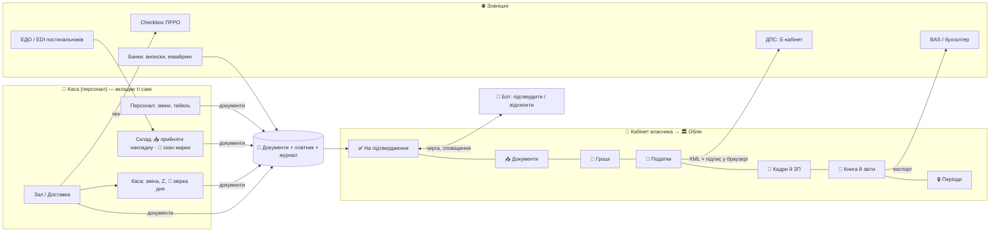

# 🏛 План «Одна система замість 1С» (затверджено власником 2026-10-19)

Мета: ресторан працює **в одній програмі ATOM** замість 5–7 (POS + ПРРО + 1С/BAS + зарплата + M.E.Doc + клієнт-банк + ЕДО). Людина лише підтверджує, звіряти руками нічого не треба.
Джерело: дослідження `reports/Одна система замість 1С.md` (поза репо) + нотатки `research_notes/`. Пов'язано: `prro-plan.md`, `податки.md`, `податки-ux.md`, `платформа-експорт.md`, `stock.md`, `money.md`, `roadmap.md`.
Позначки: ✅ є в коді · 🟡 частково · ⬜ немає · ❓ перевірити · ⚖️ рішення власника/бухгалтера.

---

## 0. Непорушні правила (для кожної фази)
1. **Тест лише на `worker-test` і atom-demo.** Фіскал — тільки тестова каса Checkbox. На робочому — без тестових чеків, звітів, працівників.
2. **Жодних справжніх подань у ДПС з тестів.** Генератори XML тестуються на файлах; подання — тільки на явну дію власника.
3. **Секрети** (токени банків, ЕДО, Checkbox) — у базі закладу зашифровано; ключі шифрування — лише `wrangler secret put`. Нічого в репо (репо приватне, але без персональних даних і секретів).
4. **Паритет бот ⇄ каса** для кожного нового потоку (накладна, звіт, нагадування, звірка).
5. **Економія запитів:** вебхуки або фонова справа раз на добу в будильнику закладу (`store.js` `alarm()` → `cron()` у `site.js`), ніколи не опитування. Нові формати даних — лише через `migrate.js`.
6. **Не податкова порада.** ATOM рахує й готує; ставки й дати власник підтверджує з бухгалтером; дисклеймер з `податки-ux.md` (розділ A) на кожному податковому екрані.
7. **Людина підтверджує** кожен документ, що йде в держоргани чи банк. Автоматично — лише розрахунки й чернетки.
8. **Не стан закладу в глобальних змінних модулів.** Ліміти безпеки не послаблювати.
9. Кожна фаза закінчується: тести (`sh tools/test.sh --quiet`), паспорт у `_team/*.md`, деплой `sh tools/deploy.sh`, push.

## 🗣 Відповіді власника (2026-10-19) — поки нічого не будуємо, спершу фундамент
1. **Офлайн** — придумати, подивившись, як роблять інші (дослідження нижче).
2. **Сканер DataMatrix** — перевіримо, коли власник підключить сканер до компʼютера. Плюс **сканування камерою телефона**, якщо сканера немає.
3. **КЕП** — правило «не зберігати КЕП» придумав не власник, а ми (для безпеки); власник погоджується, що це логічно. Дивимось, як роблять інші: у Checkbox при реєстрації кожна дія підписувалась КЕП, а дані підтягувались з ДПС.
4. **Головне:** зарано будувати. Спершу **спланувати фундамент до ідеалу**: які вкладки, як усе виглядає і зв'язано, щоб потім місяць не переробляти.

### Як роблять інші: офлайн
- Закон: офлайн лише коли немає зв'язку з ДПС; ≤36 год поспіль і ≤168 год/міс; чек має **номер з діапазону, виданого ДПС заздалегідь**, позначку «офлайн» і контрольне число; повідомлення про початок/кінець офлайну; без діапазону офлайн заборонено (з 1.08.2023; ❓ чи діє пільга воєнного стану).
- **Checkbox Kasa / Kasa Manager на ПК:** отримує запас офлайн-кодів, поки є інтернет (≈2000), далі працює без мережі (чеки, зміна, Z), після появи мережі досилає ланцюжком. POS говорить з ним локально (`http://127.0.0.1:9200`). Карткою без інтернету не можна.
- **Мобільний Checkbox:** офлайн вмикається сам (Android — бета). **Резервна каса Checkbox** на час відключень — безкоштовно.
- **Коли падає сервер ДПС** (а в нас інтернет є) — Checkbox сам переходить в офлайн у хмарі, нам нічого робити не треба.
- Практика ринку: резервний інтернет (4G-роутер / роздача з телефона) + павербанк/ДБЖ.
- Варіанти для ATOM (обрати при плануванні фундаменту):
  - (а) ПК-каса: міст до Checkbox Kasa Manager на тому ж ПК — офлайн-коди легально;
  - (б) телефон/планшет: офлайн-пречек, оплата готівкою записується, **фіскальний чек — тільки коли буде звʼязок** → порушення; тому таймер + заборона закриття готівкою після N хв або підказка «увімкніть роздачу з телефона»;
  - (в) свій ПРРО з офлайн-діапазоном у браузері — найпотужніше, але це вже «свій ПРРО» (етап 8 prro-plan).
- Джерела: buhplatforma 30459, 29160; Checkbox blog «Що ви не знали про Checkbox»; 7eminar 12693; wiki.checkbox.ua/app/pc/kasa_manager_0_3_X; ДПС памʼятка «Заборона офлайн ПРРО».

### Як роблять інші: КЕП
- **ПРРО:** кожен чек/зміну/Z підписує ключ касира або печатка. Checkbox тримає ключ у хмарі (**Checkbox.Підпис**) або дає безкоштовну хмарну печатку **DepositSign** (кваліфікований надавач, печатка на касу, не на людину; новий касир — лише логін/пароль). Тобто ключ зберігає **ліцензований надавач**, а не POS.
- **Е-кабінет ДПС і кабінет Checkbox:** ключ відкривається **у браузері на пристрої користувача** (бібліотека ІІТ), підписується кожна дія, на сервер іде лише підписаний документ — ключ сервер не бачить. Саме це власник бачив при реєстрації.
- Висновок для ATOM: (1) чеки — як зараз, через Checkbox (ключ у них); (2) звіти/ПН — **підпис у браузері власника** (його файл-ключ або Дія.Підпис/хмарний КЕП надавача) → ATOM отримує вже підписаний документ і відправляє в ДПС. Ключ ATOM не зберігає. Це варіант (б) у Фазі 4.

## 🔍 Самокритика плану (2026-10-19) — діри, які треба закрити у фундаменті
**Найнебезпечніші (без них облік не можна будувати):**
1. **Закриття періоду.** Каса дозволяє правити й перевідкривати закриті чеки. Після поданого звіту минулий період має замикатись; виправлення — лише сторно/коригування сьогоднішньою датою (+ уточнююча декларація).
2. **Зберігання 3+ роки.** Первинні документи — ≥1095 днів (ПКУ ст. 44.3), бекапи зараз 7 днів. Потрібен архів (щомісячний знімок, R2) і перевірка відновлення.
3. **Платник у кожному записі.** Мульти-ФОП зараз лише в чеках. Склад, накладні, борги, каса, працівник мають належати конкретному платнику (алкоголь — на ФОП з ліцензією; накладна виписана на конкретну особу).
4. **Журнал змін «хто, що, коли»** незмінний — для бухгалтера й перевірок (зараз події частково).
5. **Гроші в копійках (цілих)**, а не дробових гривнях — інакше копійки «пливуть» у звітах.
6. **Дата обліку ≠ час закриття:** зміна після півночі, Z-день, банк зараховує завтра — одне правило «якою датою».

**Пропущені потоки:**
7. **Передоплати й сертифікати:** для єдиника дохід — у день отримання грошей (депозит броні, сертифікат, онлайн-оплата наперед).
8. **Агрегатори (Glovo, Bolt):** дохід, комісія, виплата нетто, хто фіскалізує — звірка.
9. **Продаж компаніям** (банкет/кейтеринг по рахунку): рахунок, видаткова, акт, ПН — B2B відсутній.
10. **Чайові, переказ на IBAN без чека** — відкриті юридичні питання (вже в prro-plan) блокують податки.
11. **Кадри поза податками:** військовий облік працівників (обовʼязок роботодавця), санкнижки/медогляди, відпустки, трудові договори.
12. **Офіційна й внутрішня зарплата:** податки рахуються лише з оформленої; ставки/бонуси в касі — управлінські. Розвести поняття, не допомагати приховувати.
13. **Банківський термінал:** суму вводять вручну → помилки → звірка не сходиться. Інтеграції без нативного застосунку немає.
14. **Собівартість для обліку:** метод (середньозважена) і проводки інвентаризаційних різниць.
15. **Тютюн/кальяни** — теж акциз.

**Організаційні й юридичні:**
16. **Відкритий банкінг НБУ** — щоб тягнути виписки самим, ATOM може знадобитися ліцензія надавача послуг доступу до рахунку. Безпечніше: токен видає сам клієнт (Автоклієнт Привату), файли виписок, mono — корпоративна угода (почати папери заздалегідь, довго).
17. **Юрособа ATOM, договір-оферта, обмеження відповідальності, політика персональних даних** (РНОКПП, зарплати — Закон про захист персональних даних).
18. **Вхід бухгалтера + 2FA** для власника й бухгалтера (фінанси й підпис звітів).
19. **Ставки за датами, а не за роками** (ВЗ змінювали посеред року).
20. **Еталонні тести:** справжні (знеособлені) декларації від бухгалтера як «правильна відповідь».
21. **Ми не бачили клієнта.** Конфігурація 1С, болі, хто їхній бухгалтер — невідомі. Ризик будувати зайве. Спершу розмова/анкета.

**Цікавіші рішення, які варто розглянути:**
- **Бухгалтер — канал продажу.** Один бухгалтер веде 10–30 закладів. Кабінет «Мої клієнти» для бухгалтера (усі заклади, черга підтверджень, експорт одним натиском) → бухгалтер сам приводить клієнтів.
- **Не будувати повну бухгалтерію ТОВ, а підключити українську хмарну (Dilovod / Вчасно.Облік / Master) через API** — для ТОВ на загальній; свою легку книгу — лише для ФОП/ЄП.
- **Проводки рахувати з документів**, а не вести окремий журнал паралельно: менше дублювання, але з «замком» закритого періоду.
- **Android-застосунок (Capacitor)** закриває одразу 4 діри: легальний офлайн з кодами Checkbox, DataMatrix камерою, Bluetooth-принтери, термінал банку. Варто переглянути рішення «відкласти».
- **DataMatrix у браузері:** Chrome Android має вбудований BarcodeDetector, iPhone Safari — ні → бібліотека zxing (WebAssembly).
- **Свій ПРРО пізніше** — прибирає абонплату Checkbox і дає офлайн-діапазон самим (окупність від ~50–100 закладів).

---

## 🧱 Фундамент — остаточно (2026-10-19, планування завершено)
Друга перевірка: план звірено з кодом. Дивились на систему з чотирьох боків: бухгалтер, податкова, клієнт, що йде від нас, і 1000 закладів.

### Нові діри (знайдено в коді)
22. **Ліміт ФОП рахується в закладі.** `fis:yr` лежить у базі закладу. Але ліміт групи, поріг ПДВ і декларація рахуються **на ФОП по всіх його закладах**, плюс доходи поза ATOM. → Платник живе **над закладом** (рівень власника/Hub). Заклади раз на добу передають йому денні підсумки.
23. **Дані — денні JSON-блоки** (`closed:<день>`). Річний звіт — це сотні читань. Store уже працює на SQLite → облік вести **SQL-таблицями всередині DO закладу** з індексами (дата, платник, тип), а не KV-ключами.
24. **Часовий пояс.** Київ скрізь задається вручну через `toLocaleString`. Потрібна одна функція «облікова дата»: Київ із літнім часом + межа операційного дня закладу.
25. **Нумерація документів** суцільна для кожного платника за рік (видаткові, ПН, ПКО): лічильник під замком, без пропусків.
26. **Дохід поза касою** (банкет компанії, оренда, відсотки банку, інший бізнес ФОП) → документ «інший дохід». Без нього книга доходів і ліміт неповні.
27. **Власне споживання** (харчування персоналу, представницькі, дегустації) → списання з обов'язковою причиною.
28. **Спільна кухня кількох ФОП** (продукти купує А, продає Б) → правило «склад належить одному платнику» + документ «передача між платниками».
29. **Історію з 1С не переносимо**, лише залишки й борги на дату переходу. 1С лишається архівом для читання (3 роки). Сказати клієнту заздалегідь.
30. **Вихід клієнта:** повне вивантаження всіх його даних (Excel/JSON) одним натиском. Це і обов'язок, і аргумент у продажу.
31. **Підтримка в дедлайн** (20-го о 23:00 «не формується звіт») → аварійний експорт файлом завжди доступний + час реакції в оферті.
32. **Паритет для обліку.** Бот = сповіщення + черга «✅ підтвердити / ❌ відхилити» + посилання. Таблиці — лише в кабінеті. Таблиці в Telegram не будуємо.
33. **Фаза 0 не залежить від фундаменту**, а дедлайн 1.11 (13 днів) → іде паралельно, не чекає.
- ✅ Перевірено, що вже є (не діри): повернення (`is_return` + `related_receipt_id`) і службове внесення/видача (`/receipts/service`) уже йдуть у Checkbox.

### Інший кут: «робити менше»
- ФОП 2/3 і ТОВ на ЄП **не потребують подвійного запису**: їм потрібні книга доходів (гроші отримано) + ЗП/ЄСВ + ліміти.
- Подвійний запис (проводки, ОСВ) потрібен лише ТОВ на загальній → **експорт бухгалтеру / партнерська бухгалтерія через API**.
- **Рішення:** свій план рахунків не будуємо. Фундамент — **документи**. Проводки — лише «проєкція» для експорту.
- Це скорочує Фазу 3 приблизно вдвічі і знімає найбільшу відповідальність.

### Рішення фундаменту (будуємо першими, без нових екранів)
| # | Рішення | Навіщо |
|---|---|---|
| Ф1 | **Одна модель «Документ»** для всього: `{id, тип, платник, дата обліку, номер, статус чернетка→проведено→сторно, рядки, сума (коп.), автор, джерело: каса/бот/імпорт/банк/ЕДО, зовн. ключ (GUID 1С)}`. Не видаляється, виправлення = сторно | Накладна, списання, ПКО, ЗП, інший дохід — один механізм, один експорт, один журнал |
| Ф2 | **Платник** — сутність рівня власника (Hub): ФОП/ТОВ, режими з датою початку, ліцензії, каси, рахунки. Заклад і кожен документ посилаються на платника | Ліміти, декларації, мульти-ФОП, кілька закладів |
| Ф3 | **Гроші — цілі копійки** в нових даних; старі читаються (міграція в `migrate.js`) | Копійки не «пливуть» |
| Ф4 | **Облікова дата** — одна функція (Київ, межа операційного дня в налаштуваннях) | Зміна після півночі, Z, банк |
| Ф5 | **Замок періоду**: місяць закривається вручну або сам після подання звіту. Закритий чек минулого періоду не правиться — лише повернення сьогодні | Цифри не розходяться з ДПС |
| Ф6 | **Журнал змін** — SQL-таблиця лише на дописування: хто, що, коли, було→стало | Бухгалтер, перевірки, суперечки |
| Ф7 | **Сховище обліку** — SQL у DO закладу; денні підсумки за платником → Hub | Швидкі річні звіти, 1000 закладів |
| Ф8 | **Архів 3+ роки** — щомісячний знімок у R2 + перевірка відновлення (7-денні бекапи лишаються) | ПКУ 44.3 |
| Ф9 | **Ставки й форми «діють з дати»** (таблиця, не рік) | ВЗ, МЗП, нові XSD посеред року |
| Ф10 | **Ролі:** «Бухгалтер» (окремий вхід, лише облік), 2FA для власника й бухгалтера, журнал доступу до персданих | Фінанси й РНОКПП |

### Схема: вкладки й зв'язки

- **Каса (POS):** нових вкладок немає, лише кнопки: Склад → «📥 Прийняти накладну» (ЕДО / фото / скан) і «🍾 Скан марки» (сканер або камера); Каса → «🔎 Звірка дня» (Z ↔ банк).
- **Кабінет → 🏛 Облік** (нова вкладка):
  - ✅ На підтвердження (одна черга й у боті);
  - 📥 Документи;
  - 🏦 Гроші (банк, каса, звірка, борги);
  - 🧾 Податки (календар, декларації, ліміти);
  - 👥 Кадри й ЗП;
  - 📒 Книга й звіти;
  - 🔒 Періоди.
- **Кабінет → ⚙️ Налаштування:**
  - 🏢 Платники (майстер з 5 питань: ФОП/ТОВ, група, ПДВ, працівники, алкоголь; режим із датою);
  - 🔗 Підключення (Checkbox, банки, ЕДО, КЕП);
  - 📥 Перехід з 1С;
  - 📦 Вивантажити всі дані.
- **Бухгалтер:** окремий вхід → «Мої клієнти» (усі заклади) → той самий «🏛 Облік» кожного.

### Хто що бачить
| | Офіціант / Кухар / Кур'єр | Адмін | Власник | Бухгалтер |
|---|---|---|---|---|
| Каса (свої вкладки) | ✅ | ✅ | ✅ | — |
| 📥 Прийняти накладну, 🔎 Звірка дня | — | ✅ | ✅ | 👁 |
| 🏛 Облік: На підтвердження | — | лише склад/каса | ✅ | ✅ |
| 🏛 Облік: Податки, Книга, Періоди | — | — | ✅ | ✅ |
| 👥 Кадри й ЗП (РНОКПП, оклади) | — | — | ✅ | ✅ |
| 🔗 Підключення, 🏢 Платники | — | — | ✅ | 👁 |
| Підпис і подання в ДПС | — | — | ✅ (свій КЕП) | ✅ (свій КЕП, якщо дав власник) |

### Перемикання за оподаткуванням (те саме, інша «лінза»)
| Модуль | ФОП 2 | ФОП 3 без ПДВ | ФОП 3 / ТОВ ЄП з ПДВ | ТОВ загальна |
|---|---|---|---|---|
| Книга доходів, ліміт групи | ✅ | ✅ | ✅ | — |
| Декларація ЄП | ✅ (рік) | ✅ (квартал) | ✅ | — |
| Поріг ПДВ 1 млн → підказка | — | ✅ | — | ✅ якщо не платник ПДВ |
| ПН / ЄРПН / ПДВ | — | — | ✅ | ✅ |
| ЗП, ЄСВ, Об'єднаний звіт | якщо є працівники | так само | так само | так само |
| Акциз, ліцензія ↔ каси | якщо алкоголь/тютюн | так само | так само | так само |
| Проводки, прибуток, фінзвітність | — | — | — | експорт / партнер |
Ставки та обмеження груп ❓ підтвердити з бухгалтером (Ф9).

### Офлайн — рекомендація
1. **Збій ДПС** — Checkbox сам переходить в офлайн, нам нічого робити не треба.
2. **Немає інтернету в закладі:** резервний 4G + ДБЖ (вимога до обладнання при підключенні). Каса на ПК → міст до Checkbox Kasa Manager з офлайн-кодами (варіант а).
3. **Телефони/планшети:** лічильник 36/168 год. Через N хв без зв'язку — підказка «увімкніть роздачу», далі оплата готівкою закривається лише з фіскальним чеком.
4. **Android-застосунок** — окремим рішенням власника: закриває офлайн, камеру, Bluetooth і термінал одним проєктом.

### Остаточний порядок
1. **Зараз паралельно:**
   - Фаза 0 (е-марка до 1.11);
   - анкета й розмова з клієнтом 1С і його бухгалтером;
   - тест сканера;
   - старт довгих паперів: юрист і оферта, mono корпоративний, бухгалтер-консультант.
2. **Фундамент Ф1–Ф10** (3–4 тижні): модель, міграції, тести, без нових екранів.
3. Далі Фази 1 → 2 → 3 → 4 → 5. Вкладки з'являються разом із фазою, яка їх наповнює.
- **Правило:** будь-яка зміна фундаменту — спершу правка цього файлу, потім код.

---

## Фаза 0 — Терміново, до 1.11.2026 (1–2 тижні)
Чому першою: дата в законі, штрафи 200% (мін. 6 МЗП) за немаркований алкоголь і 100%/150% за невиданий чек.

### 0.1 Електронна акцизна марка
- ✅ Реєстр пляшок, марка у чеку при першій порції, блок продажу понад марки (`excise.js`, `exmark.js`, поле `e` = електронна).
- ⬜ Сканер каси й бота читає **2D DataMatrix** (камера), не лише 1D/ручне введення. ❓ Перевірити, чи бібліотека сканера його читає.
- 🟡 Два формати марки паралельно до **1.05.2028** (паперова + електронна); не прив'язувати логіку до дати старту (законопроєкт 15532 може перенести на 1.07.2027).
- ❓ Чи змінився формат чека Checkbox під UID е-марки — звірити з актуальною OpenAPI Checkbox до 1.11.
- ⬜ Розбір марки: 12 символів для очей + DataMatrix → нормалізований код; тест на обидва формати.
- ❓ Коди податків (`tax`) для алкоголю в чеку — з бухгалтером.

### 0.2 Ліцензія на алкоголь ↔ каси
- ⬜ Реєстр «який ПРРО вписаний у ліцензію» (кабінет → 🧾 ПРРО): нова каса без позначки **не продає алкоголь** (каса, бот, сайт).
- ⬜ Нагадування про продовження ліцензії (дата закінчення → Telegram за 30/7 днів).
- Довідка: ліцензія на роздріб у місті ≈ 12 970,50 грн/рік за кожен ПРРО.

### 0.3 Юридично чистий офлайн
Проблема: офлайн-черга каси (`00-core.js`) фіскалізує чек **після** появи зв'язку — гість не отримує фіскальний чек у момент оплати.
- ⬜ Лічильник офлайну: **36 год поспіль / 168 год на місяць**; попередження при 24 год / 140 год; блок нефіскальних продажів після вичерпання.
- ⚖️ Вибір шляху — варіанти (а/б/в) з розділу «Як роблять інші: офлайн»; рекомендація — у «🧱 Фундамент». Рішення записати в `prro-plan.md`.
- ⬜ Текст для персоналу: що робити, коли зник інтернет.

**Готово, коли:** тест на atom-demo — пляшка з е-маркою (DataMatrix) і з паперовою продається, марка в чеку тестової каси; каса без ліцензії не продає алкоголь; лічильник офлайну рахує й блокує.

---

## Фаза 1 — Міграційний комплект (3–4 тижні)
Чому: без нього першого клієнта з 1С не забрати. Конкуренти мігрують вручну — це наша ніша.

- ⬜ **Excel-шаблони + майстер імпорту** (кабінет власника → ⚙️ → «📥 Перехід з 1С»), кожен з попереднім переглядом і звітом помилок:
  - номенклатура, групи, одиниці, штрихкоди;
  - контрагенти (ЄДРПОУ/ІПН, договори) + сальдо боргів 631/361 → модуль боргів постачальникам;
  - залишки ТМЦ на дату переходу (з ОСВ) → документ «вхідні залишки»;
  - ціни;
  - персонал (посада, ставка; РНОКПП — лише у базі закладу, ніколи в логах);
  - гості й бонусні картки (з POS: Poster API/CSV).
- ⬜ **GUID 1С як зовнішній ключ** у кожному записі — повторний імпорт оновлює, а не дублює.
- ⬜ **Техкарти BAS ГХ** (брутто/нетто/втрати/версії/вкладеність): друк рецептур → парсер через Gemini → **шеф підтверджує кожну**.
- ⬜ Конектор **OData v3** лише для читання (якщо база 1С опублікована на вебсервері) — `Catalog_*`, `Document_*`.
- ⬜ (Пізніше) EnterpriseData XML.
- ⬜ Пошук дублікатів (схожі назви, старі коди) перед імпортом.
- ⬜ Відкат імпорту (бекап перед імпортом — є автобекапи, додати «знімок перед імпортом»).
- ⬜ Чек-лист переходу для клієнта (див. розділ «Перехід клієнта»).
- Бот: «📥 Перехід» → посилання на майстер у кабінеті + статус імпорту.

**Готово, коли:** на worker-test тестові файли (вигадані дані) імпортуються, повторний імпорт не дублює, техкарти з тестового друку розпізнаються і чекають підтвердження.

---

## Фаза 2 — Експорт для бухгалтера і банк (3–4 тижні)
Чому: бухгалтер лишається у своїй програмі, але нічого не вводить руками → знімає його опір.

- ✅ Експорт CSV/PDF для бухгалтера (`acct.js`): продажі, чеки, оплати, накладні, списання, витрати, ЗП.
- ⬜ **Експорт у формат завантаження BAS/1С** (щодня): продажі, надходження, списання, ПКО/ВКО. Формат узгодити з бухгалтером першого клієнта.
- ⬜ Експорт для Master Бухгалтерії / Dilovod (після BAS).
- ⬜ **Імпорт банківських виписок**: файл `1CClientBankExchange` (Windows-1251) і CSV — працює з будь-яким банком.
- ✅ Еквайринг mono — вебхуки з підписом (`mono.js`).
- ⬜ **mono корпоративний API** для виписок. ⚖️ Потрібна реєстрація ATOM як корпоративного провайдера (особисті токени власників у SaaS — порушення правил банку).
- ⬜ **ПриватБанк Автоклієнт** — виписки раз на добу (cron).
- ⬜ Відкритий банкінг НБУ (з 1.08.2026) — стежити за специфікаціями для юросіб.
- ⬜ **Автозвірка**: Z-звіт ↔ зарахування еквайрингу (з урахуванням комісії); оплата постачальнику ↔ накладна; розбіжність → сповіщення адміну.
- ⬜ Платіжки постачальникам (файл для клієнт-банку) — пізніше.
- Бот: звірка дня, «⚠️ розбіжність» з кнопкою «переглянути».

**Готово, коли:** тестова виписка (вигадані дані) імпортується, звірка знаходить і зіставлені, і розбіжні платежі; експорт відкривається в BAS у бухгалтера (перевірка на першому клієнті).

---

## Фаза 3 — Податки ФОП/ЄП і зарплата (5–6 тижнів)
Чому: закриває 100% звітності ФОП 2/3 групи і ТОВ на ЄП без ПДВ — це більшість малих закладів. Розрахунки детерміновані.

- ✅ Податковий календар + нагадування (`tax.js`), ліміти груп і сповіщення 80/95/100% (`fis:yr`).
- ⬜ **Журнал подій → проводки** за мапінгом рахунків (налаштовується один раз): категорії продажу, типи оплат, склади, статті витрат → рахунки. Журнал незмінний.
- ⬜ Звіти з журналу: ОСВ, книга доходів ФОП, P&L (є ✅ управлінський), собівартість.
- ⬜ Ковзний поріг ПДВ 1 млн грн за 12 місяців → попередження.
- ⬜ **Зарплата**: табель зі змін (є ✅) → ПДФО 18%, ВЗ 5%, ЄСВ 22% з доплатою до мінімальної; відомість.
- ⬜ **XML декларації ЄП**: F0103309 (ФОП), J0103508 (ТОВ).
- ⬜ **XML Об'єднаного звіту** F/J0500111 (нова форма з 1.08.2026).
- ⬜ Повідомлення про прийняття працівника (чернетка; підпис — власник).
- ⬜ Завантажити офіційні XSD ДПС і покрити кожен генератор тестом валідності.
- ⬜ Подання — **файлом**: власник завантажує в Е-кабінет / M.E.Doc (`ZVIT`, Windows-1251) і підписує своїм КЕП.
- ⬜ Ставки й мінімалки — з налаштувань (`RATES`), щороку оновлювати (див. «Постійна підтримка»).
- Бот: «📅 звіт готовий → переглянути / завантажити», нагадування за 5 і 1 день.

**Готово, коли:** згенеровані XML проходять валідацію XSD на тестових даних; бухгалтер першого клієнта звірив один квартал з тим, що рахує сам.

---

## Фаза 4 — ПДВ і пряме подання (6–8 тижнів)
⚖️ **Потрібне рішення власника:** правило «не зберігати КЕП» (`податки.md`) запропонували ми; власник погодився, що воно логічне. Пряме подання з ним сумісне лише тоді, коли підпис ставиться в браузері або в застосунку надавача (див. «Як роблять інші: КЕП»). Варіанти:
- (а) **лишаємо файлом** — ATOM готує XML, клієнт підписує й подає сам (безпечно, але не «одна кнопка»);
- (б) **хмарний КЕП-провайдер / SmartID Привату** — клієнт підписує у своєму застосунку, ATOM ключ не бачить (рекомендовано);
- (в) свій сервіс підпису ДСТУ 4145 поза Workers — найбільша відповідальність і ціль для злому; лише після аудиту безпеки.

Задачі:
- ⬜ Щоденна ПН на «Неплатника» (тип причини 11) із Z-звітів.
- ⬜ Експорт `ZVIT` для M.E.Doc (проміжний крок).
- ⬜ Подання через **Exchange API Е-кабінету** (`/report`, `/reportzip`, квитанції `/kvt_by_id`) — після рішення про підпис.
- ⬜ Дашборд «борг / переплата» через read-only API (`ta/splatp`, `ta/debt`) — раз на добу.
- ⬜ Контроль ліміту реєстрації ПН; попередження про ризик блокування (СМКОР). Розблокування — бухгалтер.
- ⬜ Вхідні ПН постачальників → податковий кредит (людина підтверджує).

---

## Фаза 5 — ЕДО, EDI, е-ТТН (6–8 тижнів)
- ✅ Накладні з фото/QR через Gemini (`stock.md`) — запасний шлях.
- ⬜ Вхідні документи **EDIN / Вчасно.EDI** (COMDOC_006, DESADV, INVOICE) → зіставлення GTIN/SKU постачальника з інгредієнтом → прийом з актом розбіжностей.
- ⬜ Попередження про ріст ціни постачальника → вплив на собівартість техкарт.
- ⬜ Перевірка контрагента (Opendatabot).
- ⬜ е-ТТН: підпис через застосунок провайдера (Дія.Підпис), свій підпис не будуємо. Стежити: обов'язкова з 1.01.2027 лише якщо приймуть законопроєкт.
- ❓ Які HoReCa-постачальники (Metro, Bayadera, пивоварні) реально шлють XML ресторанам — опитати перших клієнтів.

---

## Що лишається бухгалтеру (чесно казати клієнту)
Бухоблік ТОВ на загальній системі за НП(С)БО, амортизація, податок на прибуток, фінзвітність; розблокування ПН (СМКОР); лікарняні й декретні; перевірки й запити ДПС; зміна системи оподаткування; нетипові договори. ATOM передає йому готові дані.

---

## 🔁 Перехід клієнта з 1С (4 тижні, продаємо вже зараз)
1. **Тиждень 1 — аудит:** конфігурація (BAS ГХ / Бухгалтерія / 1С 7.7), POS на фронті, ФОП чи ТОВ, ПДВ, скільки кас у ліцензії на алкоголь, банки, ЕДО, обладнання (принтери, сканери, термінали). Бухгалтер вивантажує Excel: номенклатура, контрагенти, персонал, ОСВ на дату переходу, друк рецептур.
2. **Тиждень 2 — імпорт:** довідники з GUID, техкарти (перевіряє шеф), залишки й борги. Реєстрація ПРРО Checkbox (клієнт сам, своїм КЕП). **Каси вписати в ліцензію до першого келиха.** Старий РРО може працювати паралельно.
3. **Тиждень 3 — паралельна робота:** зал в ATOM, бухгалтер щодня отримує експорт у BAS. Контроль: Z = еквайринг, собівартість ≈ BAS, перша інвентаризація = ОСВ.
4. **Тиждень 4 — перемикання:** старий POS вимкнено, BAS — лише книга до фаз 3–4. Щоденний P&L у Telegram. Реєстрацію старого РРО скасувати, коли на ньому нічого не лишиться.
- Ціновий аргумент: BAS ГХ 21 600 грн + 5 400 грн/місце, Poster Pro 2 160 грн/міс + доповнення; зарахувати клієнту вже оплачений період старої системи.
- **Не казати «вас оштрафують за 1С»** — для приватного бізнесу це неправда (законопроєкт 13505 провалено 30.06.2026). Аргументи: менше програм, менше звірок, перехід за місяць, перелік заборон росте.
- Бухгалтер — співавтор експорту з першого дня; перші 3 тижні він звіряє, а не вводить.

---

## ⚠️ Ризики й втрати → що робимо
| Ризик / втрата | Як зменшуємо |
|---|---|
| **Час:** фази 0–5 ≈ 24–32 тижні; нові функції залу повільніші | Фази по черзі, кожна сама по собі корисна й продається; зал — лише баги й дрібне паралельно |
| **Гроші:** сервіс КЕП, корпоративний API mono, ЕДО-провайдери, бухгалтер-консультант | Фаза 4 лише після рішення (варіант б дешевший); ціна «облікового» тарифу окремо від 500 ₴ (⚖️) |
| **Відповідальність за помилку в податках** (штраф клієнта → претензія нам) | Людина підтверджує; дисклеймер; тести XSD; звірка з бухгалтером перший квартал; ⚖️ договір/оферта з обмеженням відповідальності (юрист) |
| **Постійна підтримка:** щороку нові форми, ставки, мінімалки | Ставки — у налаштуваннях; щорічний чек-лист у грудні: XSD, МЗП, прожитковий мінімум, ліміти груп, ЄСВ; тест падає, якщо рік у `RATES` старий |
| **Безпека ключів** (КЕП, банки) | КЕП не зберігаємо (варіанти а/б); токени зашифровані; аудит безпеки перед фазою 4 |
| **Не замінимо все** (НП(С)БО ТОВ) | Чесно в пропозиції; експорт бухгалтеру |
| **Опір бухгалтерів** | Паралельна робота, експорт у їхню програму, вони — співавтори формату |
| **Закони змінюються** (дата е-марки, е-ТТН, нова заборона 1С) | Не прив'язуватися до дат; раз на місяць перевірка новин (dtkt, 7eminar, LIGA) → запис у цей файл |
| **Навантаження Cloudflare** | Cron раз на добу, вебхуки, без опитування |
| **Неперевірені факти** (дати санкцій 1С, указ 378/2026, тарифи Checkbox) | У продажах не використовувати, доки не перевірено |

---

## ⚖️ Відкриті питання власнику / бухгалтеру
1. Перший клієнт: ФОП чи ТОВ, ПДВ, група, алкоголь, яка конфігурація 1С, яке обладнання?
2. Фаза 0.3 — який шлях офлайну (а/б/в)?
3. Фаза 4 — підпис КЕП: варіант а, б чи в?
4. Реєструємо ATOM як корпоративного провайдера mono?
5. Облік і податки — у 500 ₴ чи окремий тариф?
6. Юрист для оферти з обмеженням відповідальності — хто?
7. Бухгалтер-консультант платформи для звірки формул — хто?
8. Android-застосунок — робимо зараз (закриває офлайн, камеру, Bluetooth, термінал) чи пізніше?
9. ТОВ на загальній — експорт бухгалтеру чи партнерська бухгалтерія (Dilovod / Вчасно.Облік)?
10. Кабінет «Мої клієнти» для бухгалтерів як канал продажу — так?

---

## Журнал
- 2026-10-19 — дослідження завершено, план затверджено власником («у план, нічого не забути»). Наступне — Фаза 0 за командою «старт».
- 2026-10-19 — друга самоперевірка зі звіркою з кодом (діри 22–33), рішення фундаменту Ф1–Ф10, схема вкладок, ролей і оподаткування, рекомендація по офлайну. **Планування завершено.** Код — лише за «старт»; Фаза 0 — паралельно через дедлайн 1.11.
